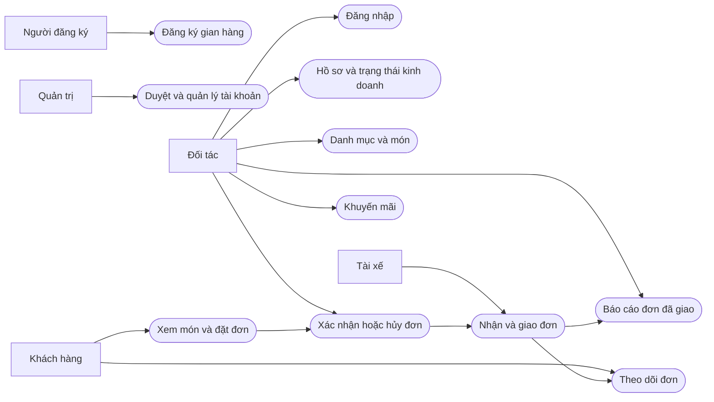
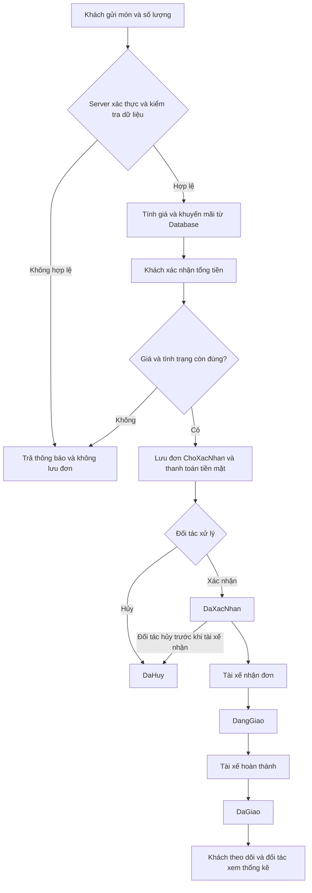
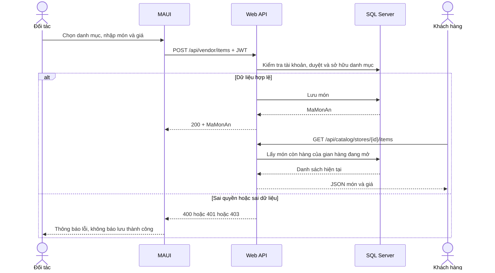

# Đặc tả nghiệp vụ module Gian hàng và Đối tác

Tài liệu mô tả bản triển khai hiện tại, phục vụ bổ sung tuần 2–4 và báo cáo tuần 12 của Nhật. Đây là đặc tả dựa trên mã nguồn, không thay thế biên bản khảo sát thực địa của tuần 1.

## Actor và Use Case

| Mã | Actor chính | Use Case | Điều kiện trước | Kết quả và ngoại lệ |
|---|---|---|---|---|
| DT01 | Người đăng ký | Đăng ký gian hàng | Chưa có tên đăng nhập | Tạo tài khoản/gian hàng chờ duyệt cùng transaction; trùng tên hoặc dữ liệu sai bị từ chối |
| DT02 | Quản trị | Duyệt, từ chối hoặc khóa | Đã đăng nhập đúng quyền | Cập nhật Database; trạng thái có hiệu lực khi đối tác gọi lại API |
| DT03 | Đối tác | Đăng nhập | Tài khoản hoạt động, gian hàng đã duyệt | JWT cho mobile/cookie cho web; sai mật khẩu, khóa, chưa duyệt bị chặn |
| DT04 | Đối tác | Sửa hồ sơ, mở/đóng | Đã đăng nhập hợp lệ | Lưu tên, địa chỉ, điện thoại, mô tả, ảnh và trạng thái; không lấy ID gian hàng từ client |
| DT05 | Đối tác | Quản lý danh mục | Có gian hàng hợp lệ | Thêm/đổi tên/xóa danh mục trống; chặn trùng tên và tác động gian hàng khác |
| DT06 | Đối tác | Quản lý món | Danh mục thuộc gian hàng | Tạo/sửa, còn/hết; món gắn lịch sử không được xóa qua API, có thể chuyển hết hàng |
| DT07 | Đối tác | Tiếp nhận đơn | Đơn thuộc gian hàng, chờ xác nhận | Xác nhận thành DaXacNhan hoặc hủy; trạng thái cũ không hợp lệ trả xung đột |
| DT08 | Đối tác | Quản lý khuyến mãi | Đã đăng nhập, món áp dụng thuộc gian hàng | Tạo/sửa/bật tắt; kiểm tra thời hạn, phần trăm, mã duy nhất; mã đã dùng chỉ tắt |
| DT09 | Đối tác | Xem doanh thu và món bán | Có thể chưa có đơn | Chỉ tổng hợp đơn DaGiao; rỗng hiển thị 0, không lấy số liệu mock |
| PH01 | Khách hàng | Xem món, đặt và theo dõi đơn | Gian hàng mở, tài khoản hoạt động, món còn hàng | Giá và giảm giá tính tại server; lưu cùng Database với đối tác; đơn chỉ khách sở hữu đọc được |
| PH02 | Tài xế | Nhận và giao đơn đã xác nhận | Có tài khoản tài xế hợp lệ | DaXacNhan → DangGiao → DaGiao; đối tác không tự đặt trạng thái giao |

## Quan hệ Actor và chức năng

## Activity xử lý đơn

## Sequence tạo món và đồng bộ khách hàng

## Cấu trúc dữ liệu và giao diện

`TaiKhoan → GianHang → DanhMuc → MonAn`; `GianHang → DonHang → ChiTietDonHang`; `DonHang → ThanhToan`, `GiaoHang`; `GianHang → KhuyenMai`. Quyền sở hữu đi từ tài khoản đăng nhập đến gian hàng trong Database. Không sử dụng ID gian hàng gửi từ mobile làm bằng chứng phân quyền.

Giao diện đối tác gồm đăng ký, đăng nhập, trang chủ, hồ sơ, thực đơn, form món, đơn hàng, danh sách/form khuyến mãi và báo cáo. Danh sách có trạng thái rỗng, thao tác API có trạng thái bận và thông báo lỗi. Các màn hình tải lại dữ liệu từ server khi xuất hiện; chưa có thông báo đẩy thời gian thực. Người dùng kéo làm mới hoặc mở lại màn hình để nhận thay đổi từ vai trò khác.

## Phiếu khảo sát cần nhóm hoàn thiện

Thông tin phải ghi sau buổi khảo sát thật: ngày giờ, địa điểm, tên/vai trò người được hỏi, người ghi nhận, bằng chứng hoặc xác nhận đồng ý. Các câu hỏi cần làm rõ:

1. Cửa hàng cần cung cấp thông tin nào khi đăng ký, ai được quyền duyệt?
2. Cửa hàng tổ chức danh mục và ngừng bán món thế nào?
3. Khi nào đơn được xác nhận, từ chối, hủy; trường hợp đã nhận thanh toán xử lý ra sao?
4. Thời điểm tài xế nhận hàng và bên nào chịu trách nhiệm cập nhật trạng thái?
5. Khuyến mãi áp dụng cả đơn hay từng món; cần giới hạn lượt và trần giảm hay không?
6. Báo cáo cần tổng giá trị đơn, tiền món, phí giao, lợi nhuận hay đối soát thanh toán?
7. Dữ liệu nào cần lưu khi mất mạng; cửa hàng có nhiều thiết bị hoạt động đồng thời không?

Nếu câu trả lời khác quy tắc đã triển khai, ghi thành yêu cầu thay đổi và kiểm thử lại; không ghi biên bản hồi tố để chứng minh một buổi khảo sát chưa có bằng chứng.
